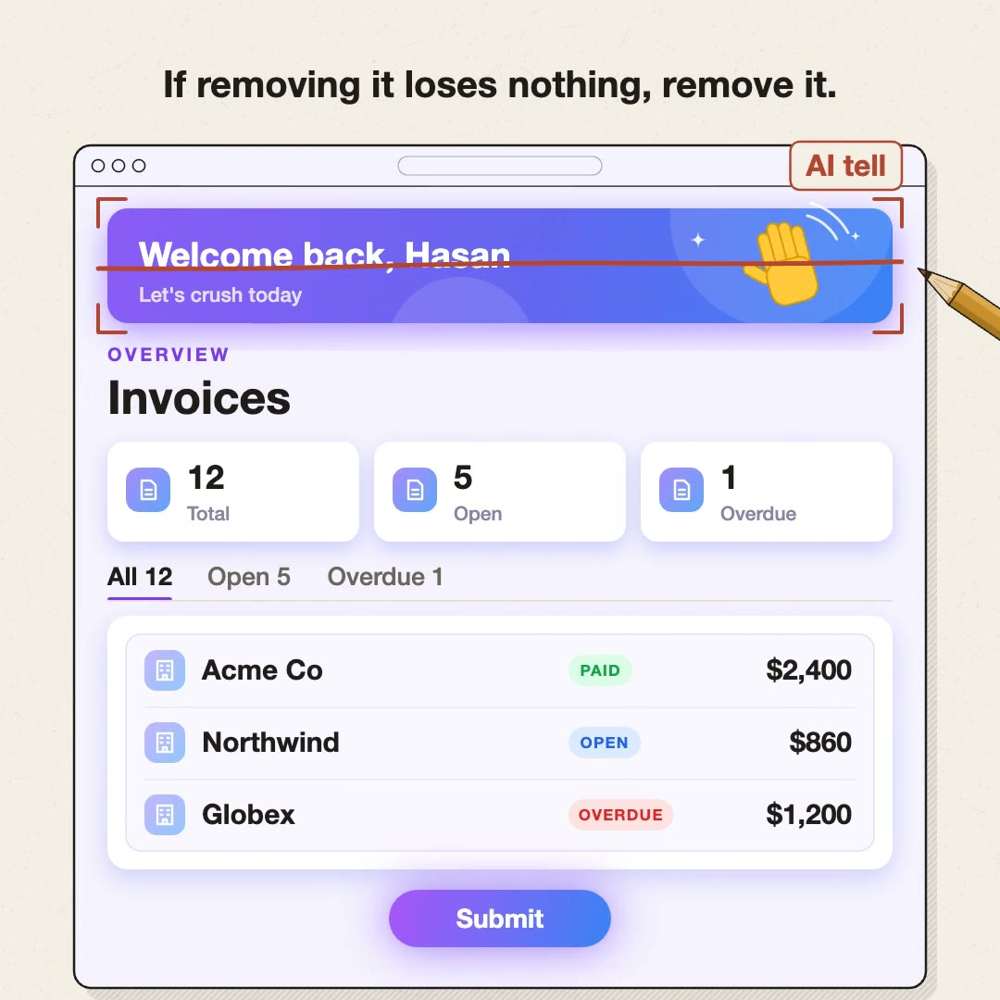

# squint

An agent skill that makes Claude Code, Codex, and other coding agents build UI where every element earns its place, and then try to break it before they ship.

[](site/public/squint.mp4)

```bash
npx skills add realhasanshoaib/squint
```

## Why

AI-built UI looks AI-built: a purple gradient, "Welcome back", icon tiles, a badge on every row, and a glowing Submit button. A list of banned patterns doesn't fix it, because the next screen is never on the list.

So squint gives the agent principles with tests it can run, such as "if removing it loses nothing, remove it" and "blur the screenshot and name the first three things you see". The examples under each principle are cases already decided, and for anything new the agent applies the principle. Then, before it reports, the agent tries to prove its own work wrong.

## What it checks

- **Every element earns its place.** If removing it loses nothing, it goes.
- **Minimal is not bare.** Icons, status dots, and avatar colors stay when they help people scan.
- **Never ship AI tells.** No purple gradients, glows, glassmorphism, or "Start your journey".
- **Layout shows what matters first.** Heading, then the main action, then the work.
- **The control fits the answer.** Two to four options are radio buttons, not a dropdown.
- **Everyone can use it.** Native elements first, and the task works with only a keyboard.
- **Fix it once, in the shared piece.** Repeated problems get fixed in the shared component.
- **Copy speaks the user's words.** "Save changes", not "Submit".
- **Every language is a full product.** Layouts mirror, and each locale gets tested.

## Try to break it

The last step makes the agent attack its own work instead of approving it. Each attack is a hypothesis it can fail: no data, a thousand items, the longest translation, keyboard only, a failed request. For risky changes, a judge model from a different family reviews the evidence without the builder's reasoning, so it isn't anchored. Fixes get retested, and the report lists what failed first.

## Use

The skill loads on its own when an agent builds or reviews UI. You can also ask for it directly:

```text
Use squint to review the settings page and fix what it finds.
```

Your project's design system wins on how things look: colors, radii, fonts, and its own rules. squint covers what holds across every project.

## The video

Claude drew every frame and synthesized every sound of the video above in JavaScript, on a canvas, following the rules in this skill.

## License

MIT
